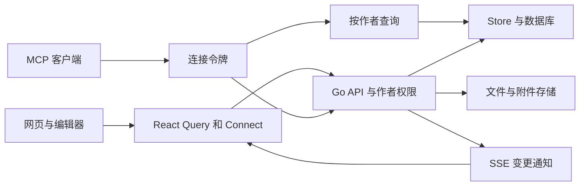

# Cat_two 功能与实现

Cat_two 是面向单账户使用的自托管笔记应用，通过 Docker 部署，在桌面浏览器中使用，默认用 SQLite。旧版本遗留的笔记、附件和关联数据按原所有者保留。此页记录仓库 `main` 的产品和实现。核对在用镜像时，读取实例 `/api/instance/profile` 的 `version` 和 `commit`，再查看镜像标签对应的源码。[部署与镜像说明](../../../../README.md)

## 网页里的功能

| 功能 | 当前用法 | 代码入口 |
| --- | --- | --- |
| 登录和安全 | 首次启动按页面引导创建管理员，随后关闭网页注册。在「系统」修改密码，在「我的账户」启用验证器两步验证。丢失验证器时按 README 从运行中的容器恢复。 | [路由](../../../../web/src/router/index.tsx) · [账户服务](../../../../server/api/user_service.go) · [恢复步骤](../../../../README.md#重置两步验证) |
| 日历和笔记列表 | 「日历」打开笔记列表。点侧栏日期筛选当天，选中日期后新笔记带上该日，点筛选标签的「×」清除。同一天更改搜索或标签时，手动设置的笔记时间会保留。日历、时间显示和日期筛选用 `Asia/Shanghai`。旧按日链接会转到当前列表。 | [首页](../../../../web/src/pages/Home.tsx) · [日期工具](../../../../web/src/lib/calendar-utils.ts) · [旧日历链接](../../../../web/src/router/LegacyCalendarRedirect.tsx) |
| 侧栏统计 | 首页日历上方显示当前账户的未归档笔记数、不同的标签路径数和记录天数。记录天数按上海时区的笔记创建日期去重。统计复用侧栏查询，随笔记变更更新，独立于当前筛选和日历排序设置。 | [侧栏统计](../../../../web/src/components/AppSidebar/CollectionStats.tsx) · [统计查询](../../../../web/src/hooks/useFilteredMemoStats.ts) |
| 桌面布局 | 侧栏默认宽 280px，可拖动分隔线调整，双击恢复默认宽度。统计、日历、视图和标签之间留出 24px，视图和标签行有 4px 间隔。单列笔记的编辑器、筛选和卡片之间留出 16px。 | [侧栏](../../../../web/src/components/AppSidebar/AppSidebar.tsx) · [宽度设置](../../../../web/src/components/AppSidebar/useSidebarWidth.ts) · [笔记列表](../../../../web/src/components/PagedMemoList/PagedMemoList.tsx) |
| 搜索和视图 | 登录后可在搜索面板选择「未归档」或「归档」。在两个列表间切换搜索范围时，日期、标签和当前视图会一起保留。可用关键词或 CEL 搜索，常用条件可保存为视图。「全部笔记」可按创建时间或更新时间排序、筛选来源及多选导出。网页创建记为「网页端」，旧笔记缺少来源时显示「未记录」。 | [搜索](../../../../web/src/components/AppSidebar/QuickFindDialog.tsx) · [列表菜单](../../../../web/src/components/MemoFeedMenu.tsx) · [视图](../../../../web/src/pages/MemoViews.tsx) · [CEL](../../../../filter/README.md) |
| 标签 | 侧栏按路径展示标签，选择父标签会包含子路径。置顶区有分隔线，展开的子标签有层级引导线。浅色主题下标签名为近黑色，深色主题的侧栏用黑底白字。重命名会带动下级路径，目标已存在时合并。置顶按账户在当前浏览器保存。「设置 → 标签」可整理斜杠两侧的空格。 | [标签侧栏](../../../../web/src/components/AppSidebar/TagsSection.tsx) · [标签接口](../../../../server/api/memo_tag_routes.go) |
| 编辑和草稿 | 富文本和 Markdown 源码共用格式操作，从「＋ → Markdown 模式」切换。新笔记和已有笔记的编辑草稿，以及待上传的附件，保存在当前浏览器。重新打开已有笔记时，符合当前版本的草稿可恢复。遇到版本冲突，编辑器会提示。 | [编辑器与格式](../../../../web/src/components/MemoEditor/README.md) · [保存逻辑](../../../../web/src/components/MemoEditor/edit/hooks/useMemoSave.ts) |
| 附件 | 用回形针添加图片、PDF、Word、Excel 等文件。可以只添加附件并保存。保存后可预览图片或下载文档，部分图片可涂画。站内下载使用当前网页会话，遇到错误时页面会显示状态。 | [附件组件](../../../../web/src/components/MemoMetadata/Attachment/) · [上传](../../../../server/api/attachment_upload.go) · [下载](../../../../web/src/lib/attachment-download.ts) |
| 私有访问和归档 | 笔记、统计及附件只对所属账号开放，旧笔记和旧空间数据沿用作者权限。详情支持笔记引用、评论、反应和导出为图片。可置顶笔记，或在归档列表查阅已归档的笔记。 | [访问规则](../../../../core/access/memo.go) · [详情](../../../../web/src/pages/MemoDetail.tsx) · [归档](../../../../web/src/pages/Archived.tsx) |
| 回收站 | 从侧栏底部打开。创建者可在回收站恢复笔记或彻底删除。恢复带回原状态和附件。超过 30 天后由服务端定期清理。彻底删除以数据库提交结果为准，文件清理失败会由后台任务重试。 | [回收站页面](../../../../web/src/pages/Trash.tsx) · [回收站接口](../../../../server/api/memo_trash_handler.go) · [保留规则](../../../../store/memo_trash.go) |
| 偏好设置 | 默认简体中文，可切换英语。主题可跟随系统，也可选浅色、深色和纸张。可配置账号资料、媒体元数据和编辑偏好。受支持的手机浏览器可把网页加到主屏幕，默认使用小猫图标。 | [语言](../../../../web/src/i18n.ts) · [主题](../../../../web/src/themes/) · [设置项](../../../../web/src/components/Settings/settingSections.ts) · [网页应用配置](../../../../web/public/site.webmanifest) |

浅色日历的低活跃度单元格使用 `rgb(185, 248, 207)`。正文采用 14px 字号、25.2px 行高，拉丁字符和数字优先使用内置 Barlow，中文按平台回退到苹方、微软雅黑等可用字体。部分旧资料引用的独立日历、附件库和地图已从网页移除。旧笔记的位置元数据可通过 ZIP 保存。 [主题色](../../../../web/src/themes/default.css) · [字体与编辑器](../../../../web/src/components/MemoEditor/README.md) · [API 变更记录](../../../../proto/api/CHANGELOG.md)

可用的 Markdown 格式及附件类型见开发 Skill 的格式清单。将其他工具生成的总结同步到 Cat_two 时，把原始 Markdown 放入 API 的 `content`。在网页手动录入时，可用 Markdown 模式纯文本粘贴。[格式清单](../SKILL.md#支持的内容格式)

## 前端、服务端和数据库

- 浏览器以 React、TypeScript 和 Vite 实现。路由及上下文携带筛选和视图，React Query 管理读取和缓存。[路由](../../../../web/src/router/index.tsx) · [上下文](../../../../web/src/contexts/) · [请求 Hooks](../../../../web/src/hooks/)
- Go 服务执行数据库迁移并提供嵌入网页、Connect、REST、文件服务、MCP 和 `/healthz`。网页先上传附件，再提交 Markdown、附件引用和时间。写入时后端记录作者、刷新标签和正文属性。编辑提交字段掩码，SSE 通知其他页面重新取数。 [启动入口](../../../../cmd/memos/main.go) · [保存逻辑](../../../../web/src/components/MemoEditor/edit/services/memoService.ts) · [笔记服务](../../../../server/api/memo_service.go) · [实时刷新](../../../../web/src/hooks/useLiveMemoRefresh.ts)
- Store 负责和数据库驱动交互。普通及 NAS Compose 默认使用 SQLite，生产数据库名为 `memos_prod.db`，使用 WAL。服务端也有 MySQL 和 PostgreSQL 驱动。[数据层](../../../../store/doc.go) · [驱动](../../../../store/db/db.go) · [SQLite](../../../../store/db/sqlite/sqlite.go)

## 数据、备份和升级

- 普通 Compose 使用 `cat_two_data` 命名卷。NAS 配置将数据目录挂载到容器内的 `/var/opt/memos`。升级时沿用现有项目和挂载，确保容器运行身份可读写。部署配置和镜像标签的操作见 README。[普通配置](../../../../compose.yaml) · [NAS 配置](../../../../compose.nas.yaml) · [备份和升级](../../../../README.md#备份和升级)
- 完整实例备份使用一致性快照，或先停止服务再复制整个数据目录和部署配置，保留 SQLite 数据库及配套文件。附件可保存在数据库、本地文件或 S3 兼容存储。新的本地附件可随数据目录迁移，已有绝对路径记录仍按原位置读取，独立目录与对象存储要一并备份。验证恢复时，使用备份副本、独立 Compose 项目及独立附件存储。 [存储设置](../../../../web/src/components/Settings/settingSections.ts) · [恢复操作](../../../../README.md#备份和升级)
- 多选可导出最多 100 条笔记，也可在「设置 → 导出和导入」导出整个账户的笔记。ZIP 含 Markdown、笔记元数据和可归档附件。导入时先预演，可保留现有、覆盖或创建副本。完成后根据逐项报告检查附件、引用、评论和归档状态。[导入导出](../../../../web/src/components/Settings/MemoExportSection.tsx) · [归档格式](../../../../core/memoexport/format.go)
- ZIP 导入可恢复同一作者的归档笔记及评论层级。新导出的 ZIP 原样存储附件数据，易压缩文件较多时归档可能变大。导入仍会检查解压大小和压缩比，已经超出限制的旧 ZIP 仍需从原实例重新导出。覆盖导入时，归档未携带的笔记引用仍保留。 [评论规则](../../../../store/memo_comment.go) · [ZIP 读写](../../../../core/memoexport/) · [导入实现](../../../../server/api/user_service_memo_import.go)

## 外部集成

在「设置 → MCP 和 API」管理连接。普通 PAT 用于 REST。专用 MCP 令牌创建后可通过 Streamable HTTP 调用 `/mcp`，有效期为 7 天（默认）、14 天、1 个日历年或永久。到期或删除连接后，下一次请求被拒绝。设置会显示首次连接的客户端 IP 和令牌到期时间。[API](../../../../proto/api/README.md) · [接入 Codex](../../../../plugins/cat-two-notes/README.md#连接-nas)

| MCP 工作流 | 工具 |
| --- | --- |
| 核对账户和视图 | `auth_get_current_user`、`user_list_memo_views` |
| 查询笔记 | `memo_search` 按字面关键词、标签、创建日、是否置顶等条件筛选活跃笔记。日期用上海时区并包含首尾。按 CEL 和归档状态查询可用 `memo_list_memos`。 |
| 读取正文和附件 | `memo_batch_get` 可按名称读取多条自己的笔记及已归档笔记正文。附件详情可用 `memo_get_memo`。 |
| 发现标签 | `tag_tree` 和 `tag_search` 按路径返回本人活跃笔记的标签，父路径的数量包含下级笔记。 |
| 创建或更新 | 用 `memo_create_memo` 或 `memo_update_memo` 写 Markdown。笔记插件在保存前预览并等用户确认。 |

旧镜像可用工具发现结果选择原有查询和逐条读取工具。参数、结果分页和兼容用法见工具说明。[MCP 参数与范围](../../../../server/mcp/README.md#tool-surface) · [笔记工作流](../../../../plugins/cat-two-notes/skills/organize-notes/SKILL.md)

开发、测试和镜像发布流程可查开发 Skill 和 README。 [开发与验证](../SKILL.md#开发与验证) · [构建和发布镜像](../../../../README.md#构建和发布镜像)
