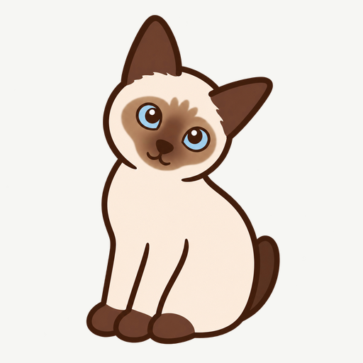

#  Cat_two

Cat_two 是面向个人的自托管笔记应用。用网页记录 Markdown 笔记和附件，按日期、标签或关键词找回内容。笔记仅限创建者登录后访问。 [产品文档](.agents/skills/cat-two-product-development/references/product-guide.md)

支持通过 MCP 连接 AI 客户端整理笔记，以及用 Telegram 和企业微信收取文本。 [连接与收件说明](.agents/skills/cat-two-product-development/references/external-api.md)

## 部署服务端

首次安装时，将本仓库根目录的 `compose.yaml` 保存到装有 Docker Compose 的机器上，在文件所在目录运行以下命令。默认从 Docker Hub 使用 `tiger2896/cat_two:latest`。 [部署配置](compose.yaml) · [镜像版本](https://hub.docker.com/r/tiger2896/cat_two/tags)

```sh
docker compose up -d
```

先在受限网络打开 `http://服务器地址:5230`，按提示创建管理员账号。Cat_two 使用 SQLite 作为唯一数据库。数据库、笔记和附件保存在 `cat_two_data` 命名卷。 [公网部署](.agents/skills/cat-two-product-development/references/deployment.md#在公网部署) · [安全说明](SECURITY.md)

当前版本启动时会拒绝不兼容的旧库。请保留旧卷和对应镜像，新建 Compose 项目并使用空数据卷。同时运行两套时，请为新实例选另一个宿主机端口。可在旧实例导出 ZIP，再在新实例导入并核对结果。 [备份与恢复](.agents/skills/cat-two-product-development/references/deployment.md#备份和升级)

## 在 NAS 上部署

在 NAS 的 Docker 应用中导入同一份 `compose.yaml`。新装时可先创建空的 NAS 数据目录，再替换 `cat-two` 服务的挂载。

```yaml
volumes:
  - /volume1/docker/cat2/data-current:/var/opt/memos
```

按目录读写权限设置 `PUID` 和 `PGID`，示例值是 `1000` 和 `10`。重建当前版本容器时沿用原数据挂载。如果要更改已有当前版本实例的 `PUID` 或 `PGID`，请先停止容器，在宿主机上调整原数据目录及其文件的所有权，确保新的 UID/GID 有读写权限。 [部署与维护指南](.agents/skills/cat-two-product-development/references/deployment.md)

## 项目来源与许可

Cat_two 基于 Memos 开发，采用 MIT 许可证。 [Memos](https://github.com/usememos/memos) · [MIT 许可证](LICENSE)
