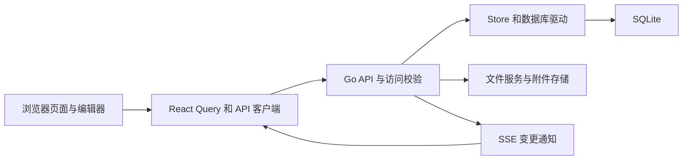

# Cat_two 功能与实现

这份说明对应 Cat_two 的 `main` 分支。日常使用可以先看功能表。开发时可以从表里的源码入口追到页面、API 和数据。检查 NAS 上的实际版本时，可以访问 `/api/instance/profile` 查看 `version` 和 `commit`，再与 GitHub 上的提交核对。

## 网页里的功能

| 功能 | 现在的用法和行为 | 代码入口 |
| --- | --- | --- |
| 登录与初始化 | 首次启动按页面引导设置管理员用户名和密码，之后关闭网页注册。实例使用私有访问策略。可以在「设置 → 系统」修改管理员密码，在「我的账户」启用两步验证。 | [路由与登录保护](../web/src/router/index.tsx)、[账户服务](../server/api/user_service.go)、[两步验证恢复命令](../cmd/memos/two_factor.go) |
| 日历和笔记列表 | 侧栏「日历」打开原时间线的列表。点日期筛选当天笔记，通过筛选标签上的「×」清除。选中日期后，编辑器会给新笔记带上这一天。打开旧的按日链接或恢复历史日期，列表与侧栏会定位到对应日期。浅色主题有笔记的日期使用 `rgb(185, 248, 207)`。 | [首页](../web/src/pages/Home.tsx)、[侧栏日历](../web/src/components/StatisticsView/)、[浅色主题](../web/src/themes/default.css) |
| 排序和来源 | 「全部笔记」菜单可按创建或更新时间升序、降序查看。侧栏的热度和日期筛选也使用所选时间类型。来源菜单可选「全部」「网页端」或「未记录」。 | [菜单](../web/src/components/MemoFeedMenu.tsx)、[排序](../web/src/hooks/useMemoSorting.ts)、[筛选](../web/src/hooks/useMemoFilters.ts) |
| 搜索、标签和视图 | 搜索支持关键词和 CEL 表达式。侧栏默认按层级展示标签。点击一个目录会列出该路径及子路径下的笔记。标签与日期可以一起筛选，普通浏览条件可以从 URL 恢复，常用条件可以保存为视图。 | [搜索](../web/src/components/AppSidebar/QuickFindDialog.tsx)、[标签侧栏](../web/src/components/AppSidebar/TagsSection.tsx)、[筛选状态](../web/src/contexts/MemoFilterContext.tsx)、[视图管理](../web/src/pages/MemoViews.tsx)、[CEL 字段与语法](../filter/README.md) |
| 标签整理 | 标签菜单支持置顶和编辑名称。置顶在当前浏览器按账户保存。重命名目录会移动它的子路径，改成已存在的标签时两边笔记合并。在「设置 → 标签」可手动整理斜杠两侧的空格，比如将 `#2027/ 08` 整理为 `#2027/08`。 | [标签接口](../server/api/memo_tag_routes.go)、[Markdown 解析](../markdown/) |
| 编辑和草稿 | 工具栏提供加粗、无序列表、有序列表和代码块，富文本与 Markdown 源码模式都可使用。编辑器也支持清单、链接及专注编辑。新笔记草稿按账户和写作位置保存在当前浏览器。已有笔记在原卡片或详情页编辑，保存后服务端更新。 | [编辑器说明](../web/src/components/MemoEditor/README.md)、[保存流程](../web/src/components/MemoEditor/edit/hooks/useMemoSave.ts) |
| 笔记内附件 | 点工具栏的回形针可选择图片、PDF、Word（`.doc`、`.docx`）、Excel（`.xls`、`.xlsx`）等文件。保存后，可以预览图片，也可以下载文档。站内文档下载使用当前网页会话，失败时可在页面查看提示和服务端返回的 HTTP 状态。只添加附件也能保存笔记。部分图片支持涂画标注，媒体元数据可在偏好设置中开启。 | [附件编辑与显示](../web/src/components/MemoMetadata/Attachment/)、[上传 API](../server/api/attachment_upload.go)、[文件服务](../server/fileserver/) |
| 整理与详情 | 笔记可置顶、归档或移入回收站。详情页提供目录、笔记引用和评论，可对笔记加表情反应，也可将笔记导出为图片。归档列表按当前账户查阅。 | [卡片菜单](../web/src/components/MemoActionMenu/)、[详情页](../web/src/pages/MemoDetail.tsx)、[归档页](../web/src/pages/Archived.tsx) |
| 回收站 | 从侧栏底部打开。只有笔记创建者能查看、恢复或彻底删除。恢复后笔记回到之前的列表或归档，附件和引用随笔记保留。到期 30 天后，服务端会定期彻底清理。 | [回收站页面](../web/src/pages/Trash.tsx)、[回收站接口](../server/api/memo_trash_handler.go)、[保留期限](../store/memo_trash.go) |
| 个人工作区 | 所有自己的笔记统一在一个列表查阅。升级后会保留旧空间的笔记和关联数据。 | [首页](../web/src/pages/Home.tsx)、[访问规则](../core/access/memo.go) |
| 导出和导入 | 「全部笔记」可多选最多 100 条后导出 ZIP，也可在「设置 → 导出和导入」导出自己的全部笔记。导入先读取并预演归档，遇到同标识的笔记可保留现有、覆盖或创建副本。最后返回逐项处理报告。 | [导出和导入页面](../web/src/components/Settings/MemoExportSection.tsx)、[ZIP 客户端](../web/src/lib/memo-export.ts)、[归档格式](../core/memoexport/format.go) |
| 外观和设备 | 默认简体中文，可切换英语。主题可选跟随系统、浅色、深色和纸张。页头提供浅色与深色快捷切换，浅色背景为 `#fafafa`。普通笔记正文为 14px，行高 25.2px，英文和数字使用内置 Barlow，中文按系统可用字体回退。网页及手机主屏幕使用小猫图标，默认显示名称为 Memos，浏览器标签标题可在站点设置中调整。 | [语言](../web/src/i18n.ts)、[主题](../web/src/themes/)、[笔记字体](../web/src/index.css)、[应用图标](../web/public/site.webmanifest) |
| 账户与实例设置 | 可以管理资料、密码、两步验证、编辑偏好和标签，在「MCP 和 API」管理访问令牌和查看接入示例。管理员可调整站点和存储设置。 | [设置项清单](../web/src/components/Settings/settingSections.ts) |

## 前端、服务端和数据库



- **前端**使用 React、TypeScript 和 Vite。[页面路由](../web/src/router/index.tsx)决定入口，[上下文](../web/src/contexts/)管理筛选和显示设置，[请求 hooks](../web/src/hooks/)管理服务端数据及缓存。
- **服务端**由 [Go 命令入口](../cmd/memos/main.go)启动并执行数据库迁移，[HTTP 服务](../server/server.go)连接 API、文件服务、嵌入式网页、MCP 和 `/healthz`。[业务规则](../core/)和 [Store](../store/doc.go)分开维护。API 定义在 [Proto](../proto/api/)，REST 接口可查 [OpenAPI](../proto/gen/openapi.yaml)。
- **数据库**随普通和 NAS 配置使用 SQLite，默认生产数据库文件为 `memos_prod.db`。服务端也有 MySQL 和 PostgreSQL 驱动。SQLite 使用 WAL，数据库与配套文件应纳入文件级备份。[数据库配置](../internal/profile/profile.go) · [驱动选择](../store/db/db.go) · [SQLite 实现](../store/db/sqlite/sqlite.go)

### 一条笔记怎么保存

1. 首页根据当前账户和日期准备编辑器。侧栏选择的日期缓存在 URL 的 `displayTime` 筛选中，前端以 `Asia/Shanghai` 计算当天的起止时间。
2. 编辑器先上传需保存的附件，再将 Markdown、附件引用和必要的时间信息发给 API。创建时服务端记录作者，处理笔记属性及附件绑定。更新时使用字段掩码提交改过的字段。
3. 服务端在数据库中写入笔记，刷新标签与内容属性。当前页面更新查询缓存，其他打开的页面通过 `/api/sse` 收到更新信号后按各自权限重新取数。

[日期工具](../web/src/lib/calendar-utils.ts) · [编辑器服务](../web/src/components/MemoEditor/edit/services/memoService.ts) · [笔记服务](../server/api/memo_service.go) · [缓存更新](../web/src/hooks/useMemoQueries.ts) · [实时刷新](../web/src/hooks/useLiveMemoRefresh.ts)

### 私有访问和输入来源

- 笔记详情、列表、统计和附件读取走后端的创建者检查。旧的公开或受保护笔记也使用这套规则，旧公开分享链接已停用。复制详情地址可以用于自己登录后打开。[访问规则](../core/access/memo.go) · [API 访问范围](../server/api/memo_access.go) · [文件读取](../server/fileserver/fileserver.go)
- 网页保存会标记 `web`，较早或未标记的笔记显示「未记录」。接口预留了 Telegram、浏览器扩展和微信的来源值。接入其他输入渠道时，需要明确登录方式、写入账户和来源标记，再把此处的实际支持情况更新到功能表。[来源字段](../proto/api/memo_service.proto) · [来源校验](../server/api/memo_create_helpers.go)
- 地图和定位入口、独立日历页与附件库已移除。旧笔记的位置元数据仍可随 ZIP 来回保存，常用的日期工作流集中在日历笔记列表。[API 变更记录](../proto/api/CHANGELOG.md)

## 数据、备份和升级

| 对象 | 存放位置和用途 |
| --- | --- |
| 笔记、账户、空间与实例配置 | SQLite 实例使用 `/var/opt/memos` 下的数据库。普通 Compose 使用 `cat_two_data` 命名卷，实际卷名含 Compose 项目名前缀。重建容器时使用同一个项目名和数据卷。 |
| 附件 | 可以存入数据库、本地文件或 S3 兼容存储，具体由实例设置决定。配置本地文件时默认模板位于数据目录下的 `assets/`。使用相对模板新增的附件跟随数据目录。显式绝对路径及已有绝对路径记录按原位置读取。 |
| NAS 数据 | [NAS Compose](../compose.nas.yaml)默认把 `/volume1/docker/cat2/data` 挂载到 `/var/opt/memos`。已有实例继续挂载存放数据的原路径，应用在容器内使用配置好的 UID 和 GID 读写。 |
| 浏览器草稿与设备偏好 | 草稿、笔记列表显示选项及部分设备偏好保存在当前浏览器。账号语言、主题和 Markdown 模式等设置可随账户在设备间使用。保存后的笔记进入服务端。 |
| 笔记 ZIP | 适合阅读、迁移和恢复个人笔记。包括 `manifest.json`、每篇笔记的 Markdown 和 JSON，以及可归档的附件。导入后查看报告，核对日期、附件、归档状态和引用。 |

### 在容器终端恢复两步验证

可在「设置 → 我的账户」用当前密码获取设置密钥，将它添加到验证器应用，再输入六位动态码完成绑定。绑定后需重新登录，请使用验证器生成的下一组验证码。

丢失验证器时，在 NAS 中打开 Cat_two 的运行中容器终端，将 `admin` 换成实际登录用户名后执行：

```sh
/usr/local/memos/memos two-factor reset --username admin
```

从宿主机执行时，使用部署该容器时的 Compose 文件和项目，运行 `docker compose exec cat-two /usr/local/memos/memos two-factor reset --username admin`。命令会清除该账户的验证器设置并注销旧浏览器会话。随后用原密码登录，即可重新绑定验证器。[恢复命令实现](../cmd/memos/two_factor.go)

### 备份和恢复

完整实例恢复使用文件级备份。备份时先停止服务或使用一致性快照，保存整个数据目录及部署配置。附件若配置在数据目录外或 S3，还需备份相应位置。升级时保持同一个数据挂载。需要在另一处测试恢复时，可以使用备份副本和独立的 Compose 项目。

[部署与升级命令](../README.md#部署服务端) · [NAS 配置](../README.md#在-nas-上部署) · [ZIP 导出](../server/api/user_service_memo_export.go) · [ZIP 导入](../server/api/user_service_memo_import.go)

用 ZIP 跨实例迁移时，请把已归档笔记的评论和大附件列入核对。已归档的父笔记可能阻止评论恢复，高压缩比的大附件可能触发 ZIP 读取限制。覆盖导入时，如果归档中没有笔记引用，已有引用会保留。[评论校验](../store/memo_comment.go) · [ZIP 读取限制](../core/memoexport/reader.go) · [引用恢复](../server/api/user_service_memo_import.go)

## 外部集成

| 入口 | 能力 |
| --- | --- |
| REST / Connect | Web 客户端使用 Connect，第三方可以通过 `/api/…` 的 REST 接口或 `/memos.api.…` 的 Connect 接口调用服务。在「设置 → MCP 和 API」可复制 REST 地址及调用示例，并创建个人访问令牌。持有令牌的程序按对应账户权限访问。 |
| MCP | 支持 Streamable HTTP 和 Bearer 令牌的 MCP 客户端可连接 `/mcp`，再用工具读取笔记或把生成内容保存为笔记。工具调用走原有 API 权限。 |
| 手机访问 | 当前仓库交付的是 Web 服务和容器镜像。支持的浏览器可以添加到主屏幕。原生 Android 客户端可作为独立项目，调用同一个服务端。 |

[API 说明](../proto/api/README.md) · [MCP](../server/mcp/README.md)

## 开发、验证和发布

日常开发用仓库根目录启动 Go 服务，在 `web/` 启动 Vite。Go、Node 和 pnpm 版本以 [go.mod](../go.mod) 和 [package.json](../web/package.json) 为准。验证时使用独立数据库，便于安全测试归档、删除和恢复。

```sh
# Terminal 1
go run -buildvcs=true ./cmd/memos --port 8081 --driver sqlite --data "$(mktemp -d)"

# Terminal 2
cd web
pnpm install --frozen-lockfile
pnpm dev
```

| 改动 | 核对方式 |
| --- | --- |
| 编辑、日历和界面 | 在 `web/` 执行 `pnpm lint`、`pnpm test`、`pnpm build`。在桌面和手机核对常用格式按钮、富文本和源码切换、历史日期筛选，以及只添加附件的笔记能否保存和下载。 |
| API、数据和迁移 | 在仓库根目录执行 `go test ./...`，按改动重点运行 `server/api/test`、`server/fileserver`、`core` 或 `store` 套件。用两个账户验证各自笔记和附件的读取权限。 |
| 导入和导出 | 用带图片、标签和笔记引用的测试笔记导出 ZIP，再在独立实例里试导入。确认首次导入、跳过、覆盖和创建副本的结果，检查重复导入后的图片显示。 |
| 回收站和标签整理 | 用两个账户验证回收站只显示自己的笔记，恢复后原状态和附件可用。准备两个同级标签和子标签，重命名其中一个到另一个后核对筛选结果，再整理带空格的标签路径。 |
| 登录和两步验证 | 在独立数据库测试首次创建管理员、再次注册被拒绝、密码和验证器登录、过期或已用验证码被拒绝以及容器终端重置。 |
| Compose 和镜像 | 用 `docker compose config --quiet` 和 `docker compose -f compose.nas.yaml config --quiet` 检查配置。使用镜像时验证 `/healthz`，再重建容器确认数据卷仍可读写。 |

`pnpm release` 将网页构建到 `server/frontend/dist`，Go 二进制将其嵌入。Docker 的构建和发布由 [Cat_two Container 工作流](../.github/workflows/cat-two-container.yml)完成。向 `main` 推送会触发验证，使用工作流的手动触发或 `[publish dockerhub]` 标记可发布 AMD64 和 ARM64 镜像。Docker Hub 编号从 `0.01` 起，每次发布递增 `0.01`。发布后核对编号、`latest` 和 `sha-<完整提交 SHA>` 是否指向同一镜像，再更新 NAS。[编号逻辑](../scripts/cat_two_docker_release.py)

改变用户可见行为时，同步更新功能表和对应的核对方式。
